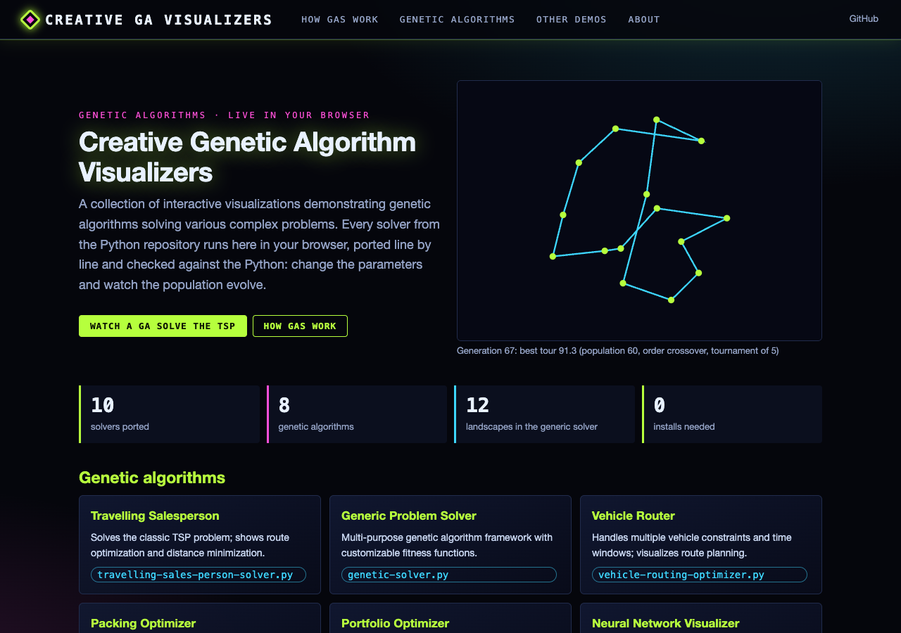
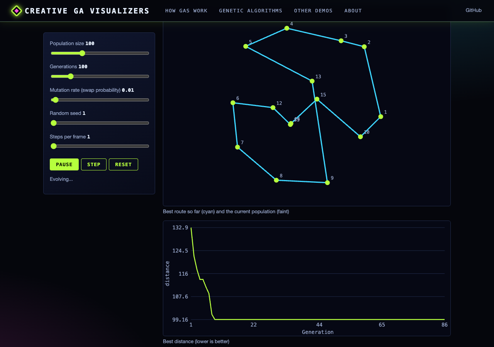
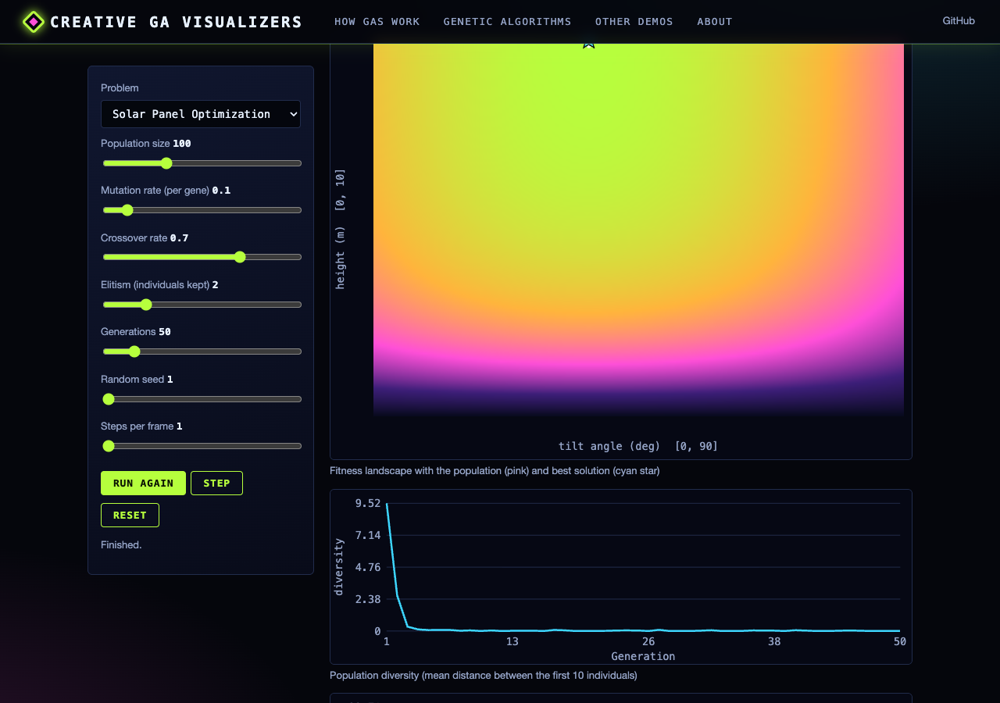
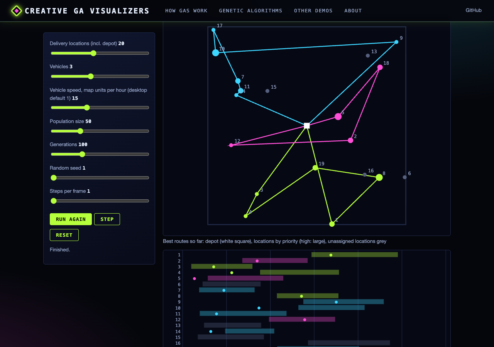
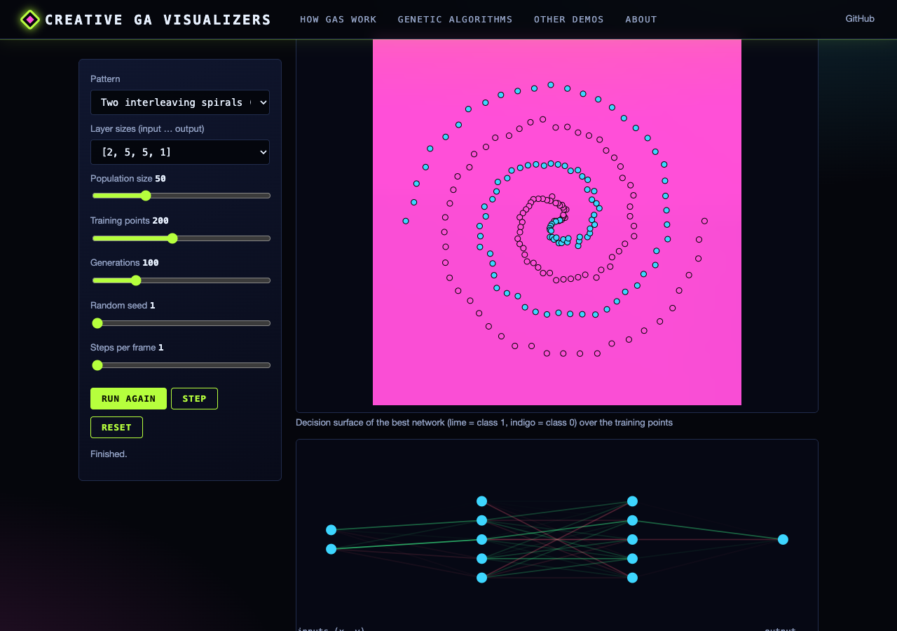

# Creative Genetic Algorithm Visualizers

This repository contains a collection of interactive visualizations demonstrating genetic algorithms solving various complex problems. Each script provides real-time visualization of how genetic algorithms evolve solutions to challenging computational problems.

## Overview

The collection includes:

1. **Flow Network Optimizer** (`flow-network.py`)
   - Visualizes maximum flow in networks (Ford-Fulkerson; no genetic algorithm)
   - Shows network bottleneck identification
   - Demonstrates flow path optimization

2. **Game Theory Evolution** (`game-evolution.py`)
   - Simulates evolution of game strategies
   - Shows population dynamics
   - Visualizes strategy performance over time

3. **Generic Problem Solver** (`genetic-solver.py`)
   - Multi-purpose genetic algorithm framework
   - Customizable fitness functions
   - Real-time optimization visualization

4. **Maze Pathfinder** (`maze-pathfinder.py`)
   - Generates and solves random mazes
   - Compares different pathfinding approaches
   - Shows evolution of path solutions

5. **Neural Network Visualizer** (`neural-vis.py`)
   - Demonstrates neural network evolution
   - Evolves the weights of a network whose layer sizes you choose
   - Visualizes learning progress

6. **Packing Optimizer** (`packing-optimizer.py`)
   - Solves 2D packing problems
   - Handles circles and rectangles
   - Shows space utilization optimization

7. **Portfolio Optimizer** (`portfolio-optimizer.py`)
   - Demonstrates investment portfolio optimization
   - Shows efficient frontier calculation
   - Visualizes risk-return tradeoffs

8. **Reaction-Diffusion Simulator** (`reaction-diffusion.py`)
   - Simulates pattern formation (Gray-Scott model; no genetic algorithm)
   - Shows emergence of complex patterns
   - Visualizes system evolution

9. **Traveling Salesperson Solver** (`travelling-sales-person-solver.py`)
   - Solves the classic TSP problem
   - Shows route optimization
   - Visualizes distance minimization

10. **Vehicle Router** (`vehicle-routing-optimizer.py`)
    - Handles multiple vehicle constraints
    - Shows time window optimization
    - Visualizes route planning

## Web version

**Live site: https://gddickinson.github.io/creative-genetic-problem-solver/** (published from `main` by GitHub Actions)

Every solver runs in the browser: each script's problem generator, fitness function and GA operators are ported to
JavaScript (`web/static/*_engine.js`) and node-tested against the Python. The tests swap one seeded random-number
generator into the real scripts and check that the JavaScript reproduces their routes, layouts, networks and fitness
histories (`scripts/make_*_fixture.py`, `tests/fixtures/`). There is one page per solver with its parameters, a live
view of the population and best solution, and a fitness-over-generations chart, plus an overview of how the GAs work.







### Run the web app

```bash
pip install -r requirements-web.txt
python run_web.py                       # http://127.0.0.1:8154
python -m pytest -q tests               # solver regressions, web API, Python-vs-JS fixtures, node engine tests
python scripts/build_static.py          # export the static site to site/
python scripts/screenshots.py --static "" tsp maze   # smoke test in Chrome (needs playwright)
```

The pages run without the server; the local app adds a small API (solver catalogue with the desktop defaults, and the
portfolio market data exactly as NumPy generates it), which the static site ships as JSON.

## Requirements

```bash
pip install numpy matplotlib networkx pandas seaborn
```

## Usage

Each script can be run independently. They feature interactive configuration and real-time visualization:

```bash
python script_name.py
```

For example:
```bash
python maze-pathfinder.py
```

Most visualizers allow you to configure:
- Problem size/complexity
- Population size
- Number of generations
- Algorithm parameters

## Features

Common features across all visualizers:

- **Interactive Configuration**: Set parameters before running
- **Real-time Visualization**: Watch solutions evolve
- **Multiple Metrics**: Track different aspects of evolution
- **Final Analysis**: Detailed results and suggestions
- **Educational Tools**: Great for learning about genetic algorithms

## Implementation Details

The genetic-algorithm solvers (all except the flow network and reaction-diffusion demos) use:
- Population-based evolution
- Fitness-based selection
- Crossover and mutation operators
- Constraint handling (capacities and time windows, non-overlapping items)
- A single objective per problem (multi-objective optimisation, e.g. NSGA-II, is on the roadmap)

## Contributing

Feel free to contribute by:
- Adding new problem types
- Improving visualizations
- Enhancing algorithm efficiency
- Adding new features

## License

MIT License - feel free to use and modify for your own projects.

## Acknowledgments

These visualizers were created to demonstrate the power and versatility of genetic algorithms in solving complex optimization problems. They serve both educational and practical purposes.


---
*Built with AI assistance from [Claude (Anthropic)](https://claude.com/).*
